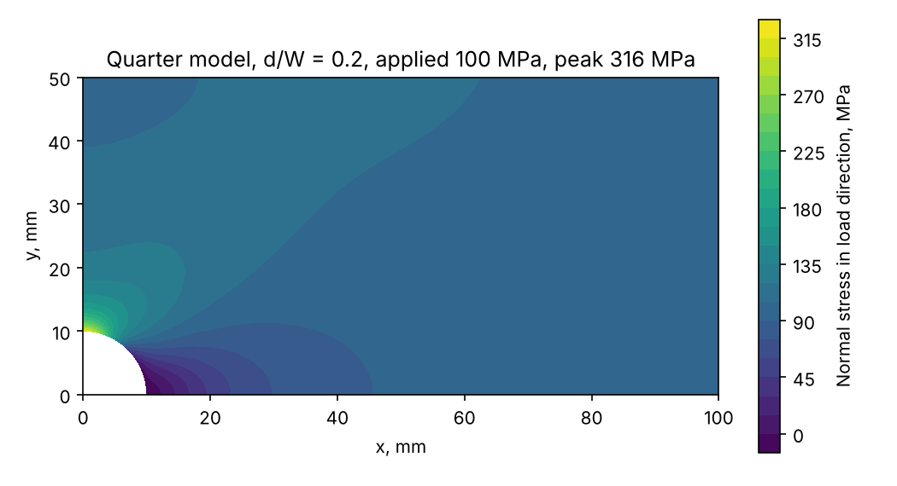
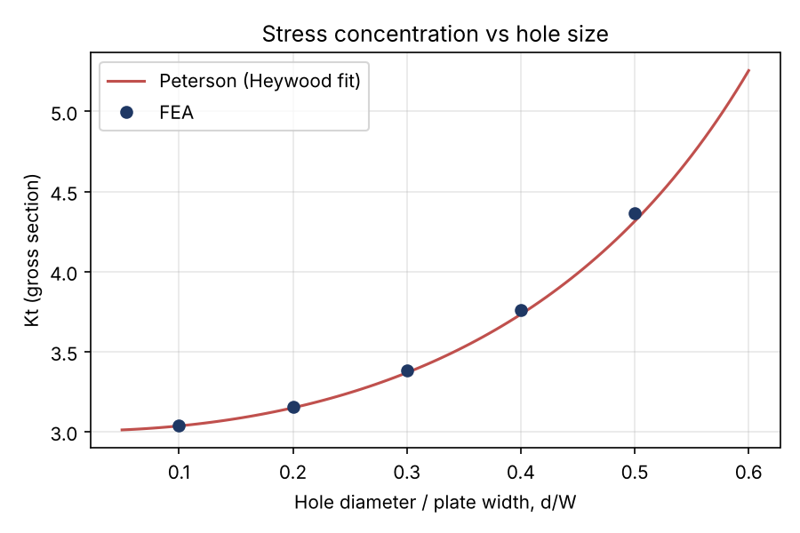
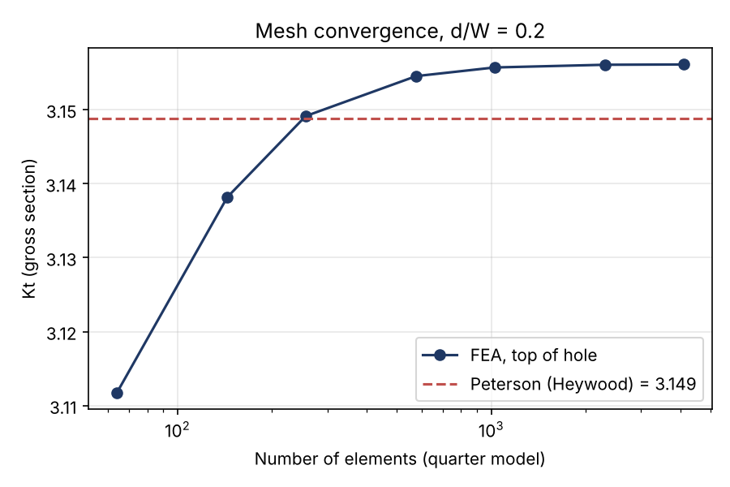

# Plate with a hole under tension

A 2D plane stress finite element solver written from scratch with NumPy and SciPy sparse matrices.



## Model

* 4 node quadrilateral elements with 2x2 Gauss integration
* Quarter symmetry: ux = 0 on the vertical cut, uy = 0 on the horizontal cut
* Graded mapped mesh that packs elements at the hole edge
* Steel, E = 200 GPa, Poisson ratio 0.3, 100 MPa gross tension on the far edge
* Plate 100 mm wide and 200 mm long
* Nodal stresses from Gauss point extrapolation, averaged across elements

## Checks

* Mesh convergence of Kt from 64 to 4,096 elements. Kt stops changing after about 2,300 elements.
* Kt against the Heywood fit from Peterson's Stress Concentration Factors for d/W from 0.1 to 0.5. The largest difference is 1.2% at d/W = 0.5.

<p>
  
  
</p>

## Output

`results/stress_field.png`, `results/kt_vs_dW.png`, `results/convergence.png`, `results/results.json`

```bash
python plate_hole_fea.py
```
