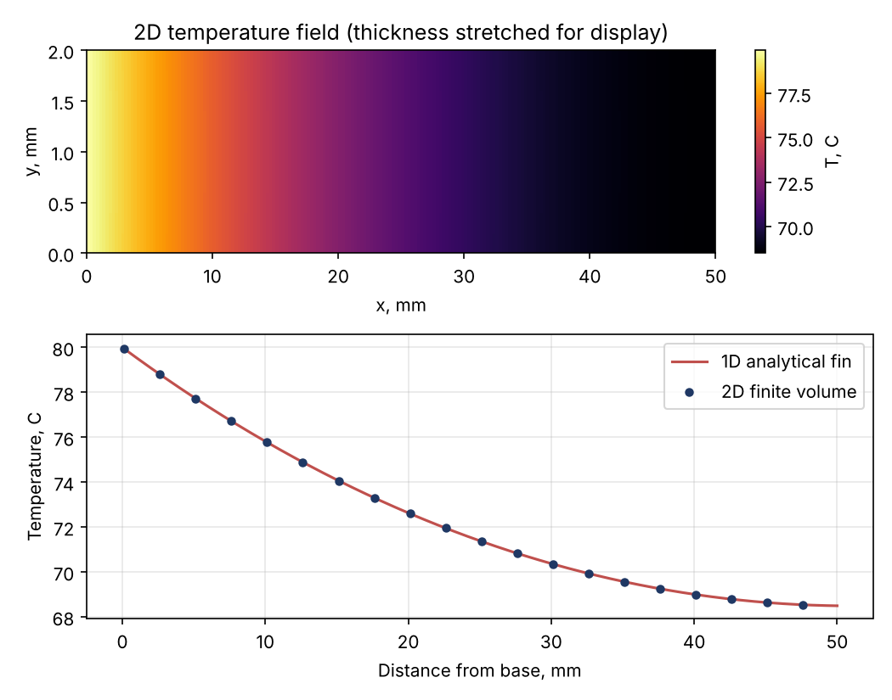
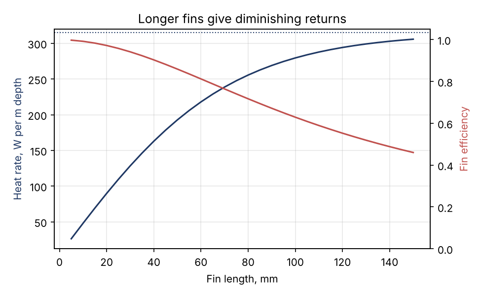

# Aluminum cooling fin

Steady 2D conduction with convection on a straight rectangular fin, solved with a cell centred finite volume method.



## Model

* Aluminum, k = 205 W/m K, 2 mm thick, 50 mm long, per metre of depth
* Base held at 80 C, air at 25 C, h = 40 W/m2K on both faces and the tip
* Each boundary face uses convection in series with half cell conduction

## Checks

* Heat rate of 192.82 W/m against 192.83 W/m from the 1D fin solution with a convective tip (Incropera Table 3.4, case A)
* Tip temperature 68.50 C against 68.49 C analytical
* Grid convergence from 10 to 400 cells along the fin

## Design study

Heat rate and efficiency against fin length from 5 to 150 mm. The 50 mm fin runs at 86% efficiency. Reaching 95% of the infinite fin heat rate takes about 135 mm.



## Output

`results/fin_temperature.png`, `results/fin_length_study.png`, `results/results.json`

```bash
python fin_heat_transfer.py
```
