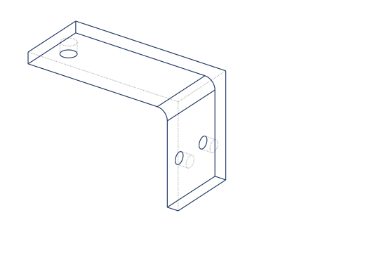
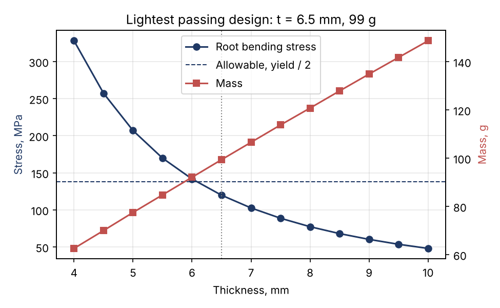

# Parametric L bracket in CadQuery

A wall mounted L bracket built as a solid in CadQuery and sized with beam theory.

<p>
  
  
</p>

## Model

* L profile extruded 40 mm wide, 90 mm arm, 60 mm flange, 6 mm inside fillet
* Two M6 clearance holes in the flange, one M8 load pin hole in the arm
* 6061 T6 aluminum, 276 MPa yield, 500 N at the load pin, required safety factor 2

## Method

For every thickness from 4 to 10 mm in 0.5 mm steps, the script:

1. Builds the solid and reads volume, mass and centre of mass from the OpenCascade kernel
2. Checks the kernel volume against a closed form volume of the profile, fillet and holes
3. Computes root bending stress (M c / I) and tip deflection (F L^3 / 3 E I) with the arm fixed at the end of the fillet
4. Keeps the lightest thickness that meets the safety factor

## Result

6.5 mm thick, 99.4 g, 119.8 MPa at the root, safety factor 2.3, tip deflection 0.81 mm. Kernel and closed form volumes agree within 0.0001% at every thickness.

## Output

`results/bracket.step`, `results/bracket.stl`, `results/bracket_iso.svg`, `results/thickness_study.png`, `results/results.json`

```bash
python bracket.py
```
