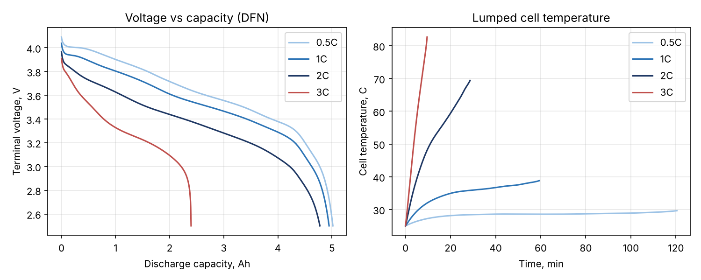
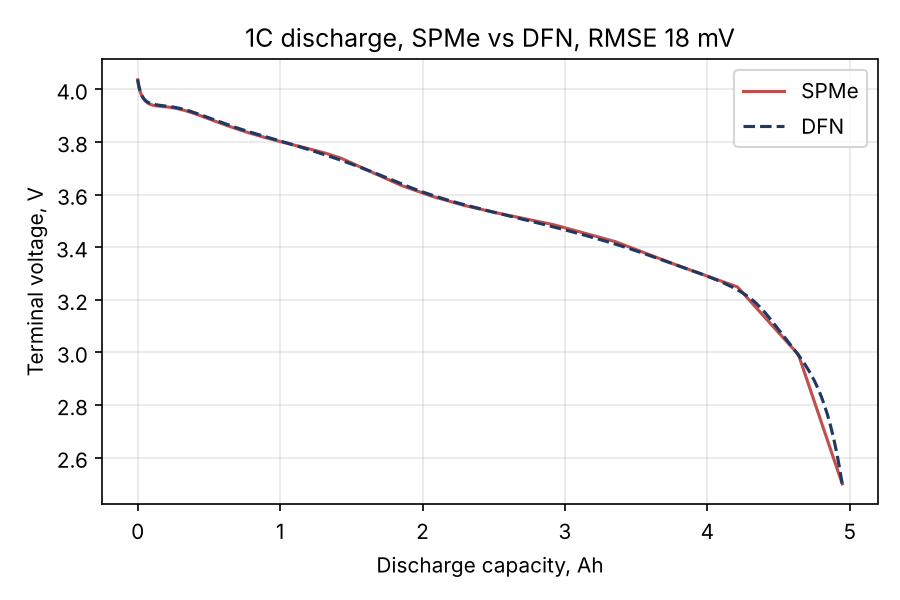

# Battery cell electrothermal discharge

PyBaMM study of a 5 Ah LG M50 cylindrical cell (Chen 2020 parameter set) with the electrochemistry coupled to a lumped thermal model.



## Model

* Doyle Fuller Newman (DFN) and Single Particle Model with electrolyte (SPMe)
* Lumped thermal model, 25 C ambient, h = 10 W/m2K on the cell surface
* Constant current discharge to 2.5 V at 0.5C, 1C, 2C and 3C, IDAKLU solver

## Checks

* C/10 discharge delivers 5.08 Ah against the 5.0 Ah nominal capacity
* SPMe against DFN at 1C: 18 mV voltage RMSE, same delivered capacity to 0.01 Ah
* Energy balance: heat generated equals heat stored plus heat lost to the surroundings within 0.03% at every C rate



## Results

* 1C: 59 minutes, 4.95 Ah, 14 C temperature rise
* 2C: 29 minutes, 4.78 Ah, 44 C temperature rise
* 3C: the cell reaches 2.5 V after 2.4 Ah and heats up by 58 C in under 10 minutes

## Output

`results/c_rate_study.png`, `results/spme_vs_dfn.png`, `results/results.json`

```bash
python battery_thermal.py
```
